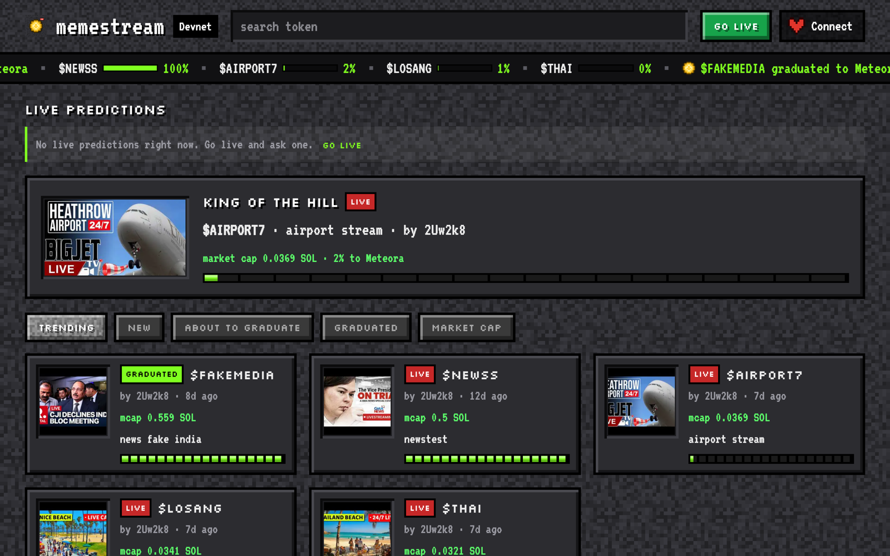
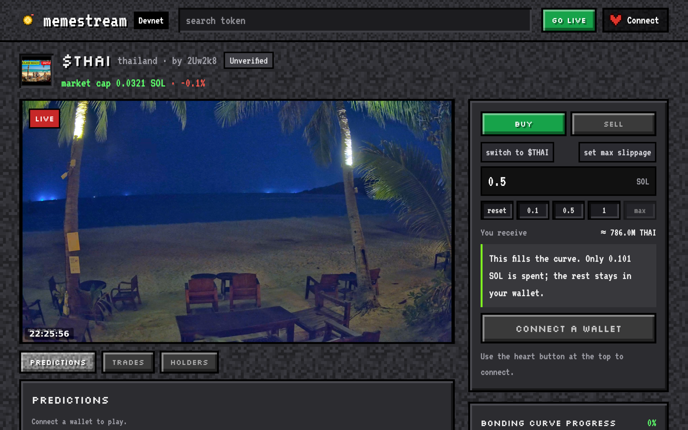
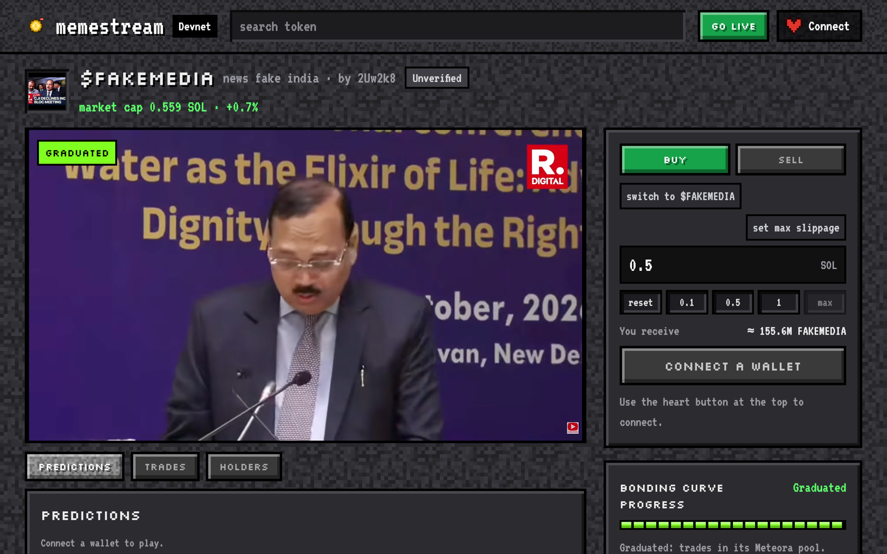
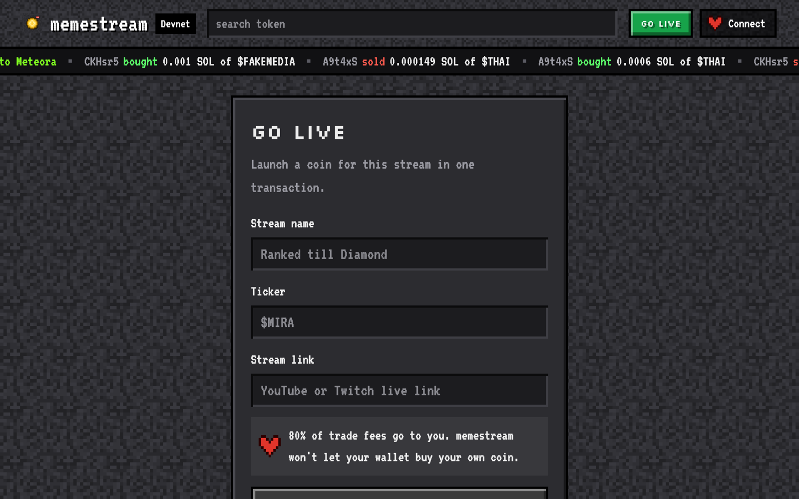
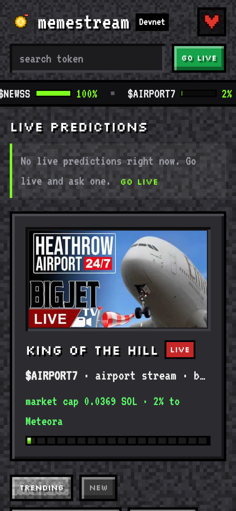
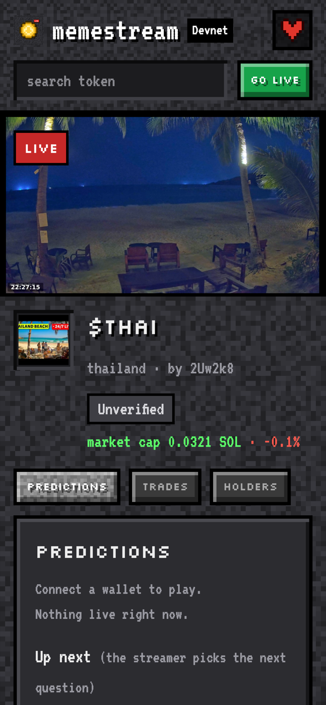

# memestream

**A prediction market for every live stream.** Each stream gets its own coin on Meteora's Dynamic
Bonding Curve (DBC). Viewers buy the stream they think will pop, and the streamer earns 64% of every
trade fee (Meteora takes 20%, memestream 16%). When the curve fills, anyone can graduate the coin live on stream into a Meteora DAMM v2
pool. On top of the coin, viewers bet on what happens next in the stream: free points for everyone,
and Polymarket-style YES/NO markets in devnet SOL.

- **Live app:** https://www.memestream.lol (devnet, test money only)
- **Demo video:** _[2-min video link]_
- **Pitch deck:** _[pitch deck link]_
- **Built for:** Colosseum (Solana track), the Meteora DBC bounty, Superteam India

## Screenshots

Taken from the live devnet app on 20 Oct 2026.

| Home | Coin page with the live stream |
|---|---|
|  |  |
| **Graduated coin (trades in its Meteora DAMM v2 pool)** | **Go live: launch a coin for a stream** |
|  |  |

| Phone: home | Phone: coin page |
|---|---|
|  |  |

## What it does

1. A streamer pastes a Twitch or YouTube link, picks a ticker and launches a coin in one transaction.
2. Viewers watch the stream on the coin page and trade the coin on the curve.
3. The streamer claims their share of trade fees at any time.
4. When the curve fills, anyone presses Graduate. The coin moves to a Meteora DAMM v2 pool and
   trading goes on there. The streamer's locked LP position earns pool fees.
5. During the stream, holders suggest yes/no questions ("Will he land the jump?"). An AI reviewer
   checks each question and picks its betting window. The streamer or a mod launches the best ones.
6. Viewers bet free points on each question. When markets are on, each question also gets a real
   on-chain YES/NO market in devnet SOL.
7. The memestream oracle resolves each question. An AI referee watches the stream and decides first.
   If it can't tell, the streamer decides. For markets, a 2-hour challenge window follows, and an
   admin settles disputes. See [The oracle](#the-oracle).

The video stays on Twitch or YouTube. memestream only embeds it and adds the coin, the overlay and
the predictions around it.

## Features live on devnet

**Coins (Meteora DBC)**
- One coin per stream, all on one shared memestream DBC config.
- Anti-sniper launch fee: it falls from 50% to 1% in 60 seconds. The trade box shows a countdown.
- Each curve trading fee: 64% to the streamer, 16% to memestream, 20% to Meteora (Meteora takes its
  20% first; the streamer gets 80% of the rest).
- `swap2` partial fill: the last buy fills exactly up to the graduation threshold.
- Permissionless graduation to DAMM v2, then trading on the graduated pool, inside memestream.
- Streamer LP fee claims on the graduated pool.
- OBS overlay in three layouts (`/overlay/<mint>?layout=a|b|c`), short links (`/TICKER`) and
  Solscan links on every trade and banner.

**UX**
- A pump.fun-style home: search, king of the hill, sort tabs and a coin grid.
- A coin page built around a big stream: the chart, tabs for trades, predictions and holders, curve
  progress and holder distribution.
- A pump.fun-style trade box: amount chips, a SOL/coin unit switch and max slippage (0.5, 1, 3 or 5%).
- A gold pixel-coin logo and favicon.

**Predictions (free points, no money)**
- 1,000 points on a wallet's first sign-in, for at most 5 wallets per IP a day.
- Holders suggest questions. jev (TypeSafe's model) reviews every question on the server, in about a
  second, before anyone else sees it.
- The streamer or a mod launches questions. Up to 10 run at once per coin.
- The oracle resolves each one: the AI referee first, the streamer as the fallback.
- Bettors can flag a result. Enough flags mark it disputed.

**Prediction markets (devnet SOL, Polymarket-style)**
- Each live question gets a MetaDAO conditional vault plus one Meteora DAMM v2 YES/NO pool.
- Buys and sells route with split-and-swap maths from Gnosis's FPMM design, so any bet size fills.
  There is no bet cap.
- A 0.3% pool fee.
- Every result is only a proposal for 2 hours. Any holder can challenge it with a 100-point
  bond. An admin then upholds, overturns or voids. With no decision in 24 hours, the market voids
  (refunds) as a last resort.
- Streamers and mods can't bet on, challenge or judge their own coin's markets.

## The oracle

Every prediction needs someone to say what happened. memestream's oracle is an AI referee that
watches the stream, with people as the fallback and the court of appeal.

**Before betting opens**
- jev (TypeSafe's model) reviews each question on the server and picks its betting window.
- When the question goes live, an AI writes a short check rule: what a viewer would see on stream
  that means YES or NO. Everyone sees it under the question ("AI checks: …").

**While betting is open, and a few minutes after**
- The server grabs pictures of the stream from Twitch and YouTube, skipping repeats.
- A vision model (Gemini 2.5 Flash) turns each picture into facts, each tagged with where it came
  from: the game screen, the camera, an overlay or chat. Overlay and chat text is dropped, so a
  viewer's donation alert can't fake a result.
- Only pictures taken after betting closed count as evidence.

**When betting closes**
1. **The AI decides first.** jev reads the evidence and answers YES, NO or "can't tell". It needs at
   least 70% confidence. A real-SOL market also needs two separate fresh pictures that agree.
2. **If the AI can't tell,** the streamer or a mod decides with "Decide: YES / NO". This happens when
   the AI is unsure, gets no fresh picture, fails, or runs out of time. Anyone who holds a bet or
   market shares on that question can't decide it.
3. **For real-SOL markets, every result is a proposal.** Any holder can challenge it for 2 hours. A
   streamer's fallback call always goes to an admin before it settles. The admin upholds, overturns
   or voids. With no decision in 24 hours, the market refunds.
4. Free-points results pay out at once. Bettors can still flag them, and enough flags mark the
   result disputed.

**Running it**
- A small worker on Railway calls the oracle every minute (`/api/predictions/tick`, guarded by a
  secret), so questions resolve even when nobody has the page open.
- A daily budget caps AI calls, per coin and in total. It costs well under 1 cent per question.
- memestream's 16% share of coin trading fees pays for the AI referee.
- All AI keys stay on the server. The browser never sees them.

**Next:** the referee gets a fresh frame every minute and a 30-second clip with sound when betting
closes, so it can judge fast moments that a still picture misses.

## How we use each Meteora feature

| Step | What happens | Meteora feature |
|---|---|---|
| Go live | A streamer launches a coin in one transaction | DBC pool on our shared config |
| First minute | The launch fee falls from 50% to 1% in 60 s | DBC fee scheduler + dynamic fee |
| Trade | Buy and sell on the curve; the last buy fills only up to the threshold | DBC `swap2` partial fill |
| Earn | The streamer claims 64% of every trade fee, any time | DBC creator trading fee claim |
| Graduate | Anyone migrates the full curve, live on stream | DBC to DAMM v2 migration |
| After graduation | Trading goes on in memestream, in the coin's DAMM v2 pool | DAMM v2 swaps |
| Forever | The streamer's locked LP position NFT earns pool fees; claim in one click | DAMM v2 position fees |
| Markets | Each question's YES and NO tokens trade in one pool, at a 0.3% fee | DAMM v2 pool (YES/NO pair) |

### Fee flow

| Who | Before graduation | After graduation (mainnet preset) |
|---|---|---|
| Streamer | 64% of curve trading fees | 100% of the pool's LP fees (all graduated liquidity is theirs, locked forever) |
| Platform | 16% of curve trading fees + 0.045 SOL of each 0.05 SOL launch fee | none |
| Meteora | 20% of curve trading fees + 10% of the launch fee | its protocol share of pool fees |
| Liquidity | locked in the curve | 100% permanently locked in DAMM v2 |

The devnet config uses a 0.1 SOL threshold (so testers graduate with faucet SOL), a free launch and
a 50/50 LP split. The mainnet preset (3 SOL threshold, 0.05 SOL launch fee, 100% LP to the streamer)
runs on Meteora's real programs in `test/integration/mainnet-config.surfpool.ts`.

### Addresses

| | Devnet | Mainnet |
|---|---|---|
| memestream DBC config | `Buiw2JGkLJKgUcYPhsJ64L8x6xANqzHFxxnuc31mWyVg` | _[mainnet config]_ |
| DBC program | `dbcij3LWUppWqq96dh6gJWwBifmcGfLSB5D4DuSMaqN` | same |
| DAMM v2 program | `cpamdpZCGKUy5JxQXB4dcpGPiikHawvSWAd6mEn1sGG` | same |
| MetaDAO conditional vault | `VLTX1ishMBbcX3rdBWGssxawAo1Q2X2qxYFYqiGodVg` | not used on mainnet yet |
| Markets oracle | `6wVWwYoF4gEP5mVMcTLYAhgNpvXpYTWcY8hdfi68m4o5` | _[mainnet oracle]_ |

## Traction

**Devnet, as of 12 Oct 2026, 17:22 IST; mostly our own testing:** 23 coins launched on our config,
68 trades, 2.38 SOL volume, 8 graduations to DAMM v2, 0.0071 SOL in creator fees claimed (8 claims),
8 trading wallets, 7 prediction markets created (devnet SOL).

_[Mainnet numbers: coins launched, trades, SOL volume, graduations, streamer earnings]_

## Architecture

- `src/lib/dbc/` and `src/lib/damm/`: on-chain logic for coins. Only this code touches the Meteora SDKs.
- `src/lib/markets/`: market builders (create, buy/sell, close, resolve, redeem), the MetaDAO vault
  module and the FPMM maths.
- `src/lib/predictions/`: the predictions engine and its rules (pure functions, shared by server,
  browser and tests).
- `src/server/`: reads coins and builds transactions. The server never holds user keys. The markets
  oracle key signs only market steps (create, close, resolve).
- `src/app/api/`: JSON routes the browser calls. Every route that reaches the chain goes through a
  shared RPC guard and per-client rate limits in Upstash Redis.
- `src/components/`: the UI. It never builds transactions; the wallet signs what the server returns.
- AI calls (jev review, the vision check) run on the server only. `npm run check` fails if the
  client bundle mentions them or holds anything that looks like a key.
- `design/`: design spec and the HTML mock the styles come from.

Money safety: the server builds each transaction, the wallet signs and sends it, and the app
polls until it lands, fails or expires. A trade never fills worse than the price you saw: a moved
price makes it fail instead. Max slippage comes only from a whitelist (0.5, 1, 3 or 5%).

Fair by default: a streamer's wallet can't buy their own coin here. The first coin keeps its ticker,
look-alike tickers are hidden, and every coin shows "Unverified" until channels are verified.

## Run it locally

Needs Node 20+. No faucet, no wallet extension. The first `dev:chain` run downloads Meteora's
programs from devnet into `.cache/`; after that it runs fully offline.

```bash
npm install
npm run dev:chain   # local offline chain with Meteora's real programs; seeds coins
npm run dev         # in a second terminal; open http://127.0.0.1:3000 (exactly this address)
```

Connect with **"Test wallet (localhost)"**. It only exists in local development, answers only this
app's own page, and signs only transactions this server built.

Feature flags: `MEMESTREAM_PREDICTIONS=1` turns on predictions; `MEMESTREAM_MARKETS=1` adds the
on-chain markets. Server-only env: `TYPESAFE_API_KEY` (without it, questions wait for staff),
`TYPESAFE_MODEL` (default `jev-latest`).

## Tests

```bash
npm run check                  # types, lint, unit tests, coin life on Meteora's real programs, build, bundle scan
npm run test:clock             # slow (~2.5 min): real-time clock; launch fee settles to 1%, blockhashes expire
npm run e2e:predictions:local  # a full predictions round on devnet + real Upstash (see TESTING-devnet.md)
npx tsx scripts/e2e.mts        # clicks through the running app like a user (needs dev:chain + dev)
npx tsx scripts/mid-trade.mts  # reload / second tab / triple click mid-trade
```

`scripts/markets-e2e.mts` plays one full market round on devnet (create, buy, sell, close, propose,
challenge window, resolve, redeem). `scripts/devnet-pass.mts` reruns the whole coin life on devnet.

**Proof on devnet**, through the app's own server code: graduate
`37taDtwdmpxRi2WLtUmVG4LC11Bgsn7Apzu5WCgbAMMmGrhtMgofq3n3NvoZzWgFJgwBLAZfpr2b2Arn2HsLdkQy`,
pool buy `4SsiqQ4G2KLwLKCdxjVcbyNLvvdW3NyKQivK8Wv2ewsBDFXcZTwvgXydp2CnMMhK9GYTYQSK73rGsnzM7hQ6ofSd`,
streamer LP claim `ixVM6DbMHQqJpXaUY8WGosAQsQ3FufGea1yC9XWgEQ7w8zxAAXpfXvdkmxeX3N6cPkyHjUABh7rUp3sbdEjjG3h`.

## Security and audits

- Three security audits of the coin and trade code (Solana auditor checklists), plus money-flow
  audits. We fixed every critical, high and medium finding.
- Predictions: audited twice before merge.
- Prediction markets: four audit rounds. Fixes include unguessable question ids, a registry of
  oracle-made markets, pools checked on chain, no free refund option, and staff who can't challenge
  or judge their own coin.
- Rate limits shared across servers (Upstash Redis), a site-wide RPC budget and a Vercel firewall rule.
- Mainnet blockers stay open and listed in [MAINNET-CHECKLIST.md](MAINNET-CHECKLIST.md). Markets stay
  off on mainnet until every one is done (admin paging, void at cost basis, a scheduled sweep, an
  external audit of the challenge economics, a legal review and geoblocking).

## Known limits

- A voided market refunds 0.5 SOL per share, whatever each share cost. Refunds at each holder's cost
  basis aren't built yet.
- Markets are YES/NO only.

## MetaDAO license note

Prediction markets call MetaDAO's deployed conditional vault program on devnet. That program is
licensed under BSL 1.1. We only call it through its published client package; we copy none of its
source into this repo. The market maths follows the Gnosis FPMM design, for two outcomes.
